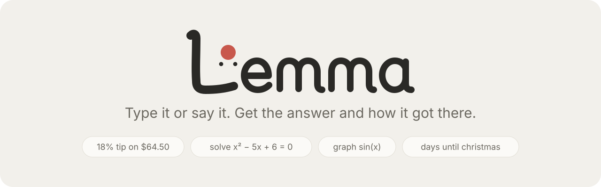
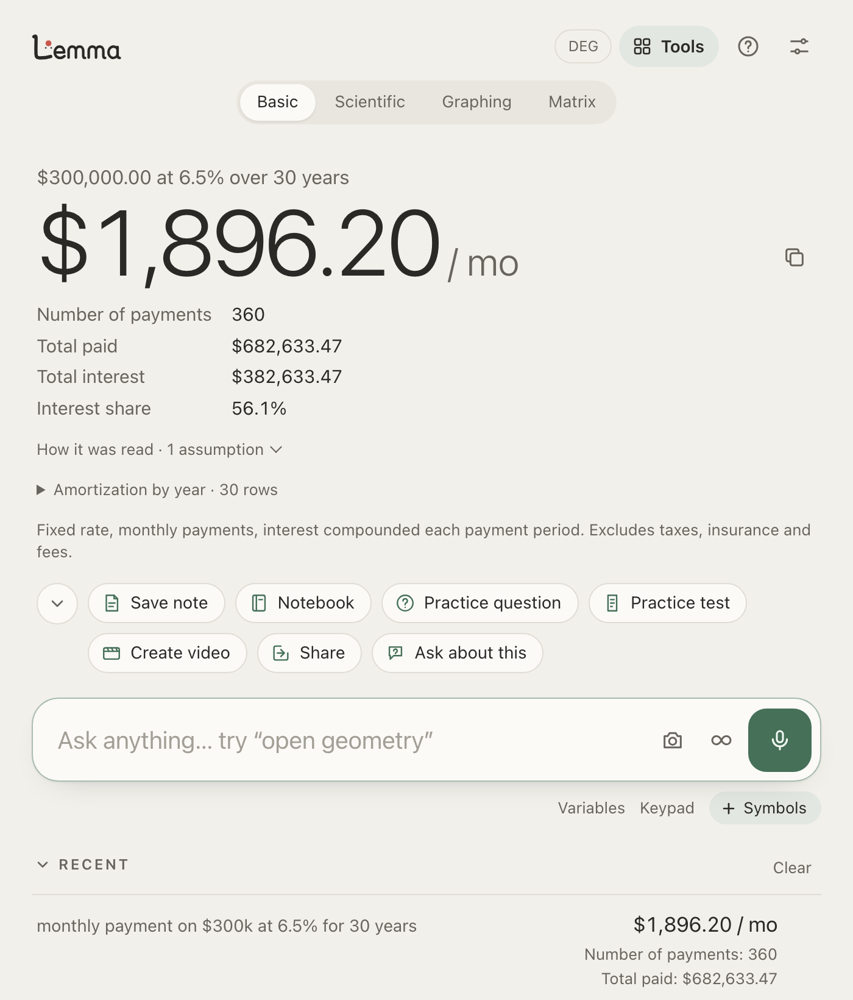
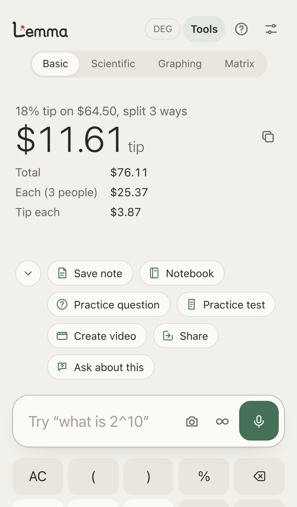
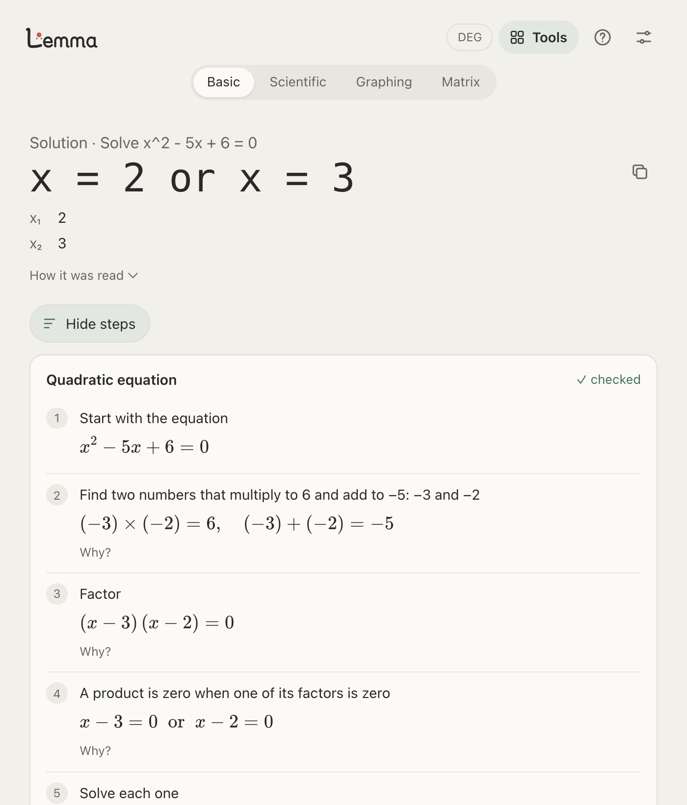
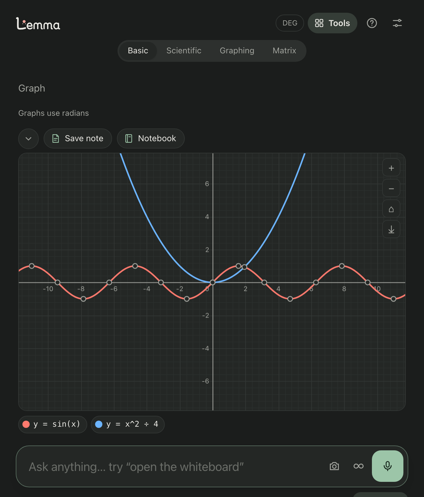
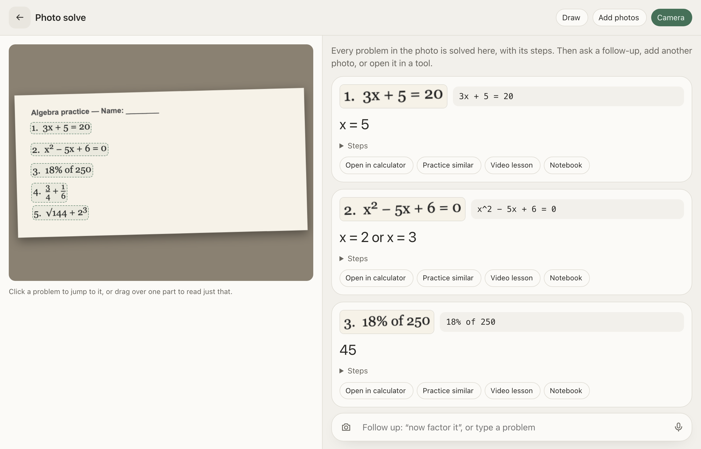
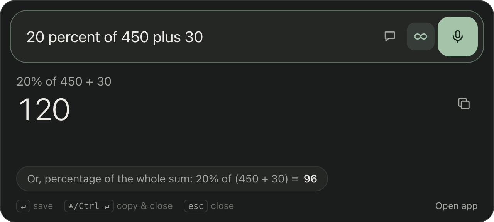

<p align="center">
  <picture>
    <source media="(prefers-color-scheme: dark)" srcset="docs/images/banner-dark.svg">
    
  </picture>
</p>

<p align="center">
  
  
  
</p>

<p align="center">
  <a href="#what-it-does">What it does</a> ·
  <a href="#run-it">Run it</a> ·
  <a href="#where-it-runs">Where it runs</a> ·
  <a href="#how-it-works">How it works</a> ·
  <a href="docs/DETAILS.md">Full details</a>
</p>

Lemma is a calculator you talk to like a person. Type "monthly payment on $300k at 6.5% for 30 years" and it answers $1,896.20 a month, then shows the total paid and the year-by-year table behind it. Say the same thing out loud and you get the same answer.

It runs in the browser, as a desktop app with a hotkey, as an iPhone and Android app, and as a browser extension. After the first load it works offline.

<p align="center">
  <picture>
    <source media="(prefers-color-scheme: dark)" srcset="docs/images/calculator-dark.png">
    
  </picture>
  &nbsp;
  
</p>

## What it does

- **Plain-language math.** Percentages, units, dates, loans, tips, currency, statistics. "18% tip on $64.50 split 3 ways" gives $11.61 and $25.37 each.
- **Worked steps.** Algebra and calculus go through SymPy, and most answers can show how they got there, line by line, with a check mark when the result was verified.
- **Graphs.** `graph sin(x) and x^2/4` draws both curves and marks the roots, peaks and crossings.
- **Photo solve.** Drop in a photo of a worksheet. Each problem is read on the device and solved as its own card, next to the part of the photo it came from. A line it can't read for sure is held back for you to check instead of being answered.
- **Study tools.** Notebooks, practice questions and tests, an exam simulator, a whiteboard, video lessons and a study agenda.
- **An optional assistant.** Off by default. It can run on your own device (a 570 MB model, downloaded once) or through your own key for Anthropic, OpenAI, Gemini and others. It never does the math itself: every number comes from Lemma's calculator, and each step shows up as a chip you can click.

<table>
  <tr>
    <td width="50%"></td>
    <td width="50%"></td>
  </tr>
  <tr>
    <td align="center"><sub>Steps for <code>solve x^2 - 5x + 6 = 0</code>, checked</sub></td>
    <td align="center"><sub><code>graph sin(x) and x^2/4</code></sub></td>
  </tr>
  <tr>
    <td colspan="2"></td>
  </tr>
  <tr>
    <td colspan="2" align="center"><sub>Photo solve: five problems from one picture, each with its answer and steps</sub></td>
  </tr>
</table>

### The desktop quick calculator

Press **⌘/Ctrl + Shift + Space** anywhere and a small calculator opens over whatever you're doing. **⌘/Ctrl + Shift + M** opens it and starts listening. Enter saves the answer, **⌘/Ctrl + Enter** copies it and closes.

<p align="center">
  
</p>

When a question can be read two ways, Lemma answers the standard reading and offers the other one. `20 percent of 450 plus 30` is 120, and right under it: 20% of (450 + 30) = 96.

## Run it

You need Node 20 or newer.

```bash
npm install
npm run dev            # http://localhost:5178
```

```bash
npm test               # unit, correctness and speed tests
npm run e2e            # build, then the browser tests (Chrome, Firefox, Safari, Android and iPhone views)
npm run build          # production build in apps/web/dist
npm run preview        # serve that build on :4178
npm run desktop        # build, then open the desktop app
npm run desktop:dist   # desktop installers in apps/desktop/release
```

The phone apps are in [`apps/mobile`](apps/mobile/README.md), the browser extension in [`apps/extension`](apps/extension/STORES.md) and the optional sync server in [`apps/sync-server`](apps/sync-server/README.md). Each has its own steps.

## Where it runs

| Platform | Install | Tested |
|---|---|---|
| Chrome, Edge, Brave, Firefox, Safari | Website, or install it as an app | The browser tests run in the Chrome, Firefox and Safari engines |
| iPhone and Android | Native apps (Capacitor) | iOS runs in the Simulator. The Android project is generated but hasn't been compiled yet |
| macOS, Apple Silicon and Intel | `.dmg` | The packaged app passes its self-test, built-in assistant included |
| Windows x64 | Installer | Passes the self-test under Wine. Not run on a real Windows PC yet |
| Linux x64 | AppImage | Passes the self-test in an x64 Linux container |

The installers aren't code-signed yet, so macOS and Windows will warn the first time you open them.

## How it works

- **The math is exact.** Numbers are decimals at 50 digits, so `0.1 + 0.2` is `0.3` and `sin(30°)` is `0.5`. A result gets `≈` only when the display rounds it.
- **The parser is hand-written.** It reads plain English, spoken numbers and symbols, and it flags an ambiguous reading instead of picking one quietly.
- **Engines load when you need them.** The main bundle is 18 KB gzipped. Heavier parts like SymPy (about 12 MB) only download the first time you use them.
- **It's fast.** Typed arithmetic takes about 0.015 ms. The benchmark tests fail if a common question takes longer than 5 ms.
- **Your data stays on your device.** Nothing you save goes anywhere unless you turn on sync. Sync is encrypted before it leaves, and the sync server only ever stores encrypted blobs.

<details>
<summary><b>Project layout</b></summary>

```
apps/web               The app itself: vanilla TypeScript, no framework
apps/desktop           Electron shell: hotkeys, the quick calculator, tray, the on-device model
apps/mobile            iOS and Android apps (Capacitor)
apps/extension         Browser extension (Manifest V3)
apps/sync-server       Optional sync server that stores only encrypted data
packages/math-core     Lexer, parser and exact evaluator, with no DOM
packages/runtime       Sends each question to the right engine
packages/*-engine      Units, dates, finance, currency, graphs, symbolic math, statistics, science,
                       geometry, physics, steps, practice, exams, notebooks, the assistant and more
packages/sdk, cli      createLemma() for JavaScript, and the `lemma` command
```

The full list, one line per package, is in [docs/DETAILS.md](docs/DETAILS.md#layout).
</details>

## Testing

There are 1,560 browser tests across five browser and phone setups, plus unit tests for the engines and stress tests that throw 10,000 fuzzed phrases and inputs like a 10,000-digit number at each one. The desktop app has its own self-test: `npm run smoke -w @lemma/desktop -- --ai` starts the packaged app, checks a calculation in both windows and asks the built-in assistant a question.

## Not done yet

- The installers aren't signed.
- The assistant has only been tested against mocked APIs, never a live key. The built-in model has been run for real.
- Voice hasn't been tested with a real microphone, only with synthetic speech.
- `lemma.app` is a placeholder until there's a real domain.

Everything else, feature by feature, is in [docs/DETAILS.md](docs/DETAILS.md).

## Author

Lemma is built by **[sh1lll](https://github.com/sh1lll)**.

## License

[MIT](LICENSE)
